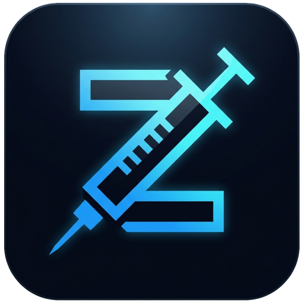
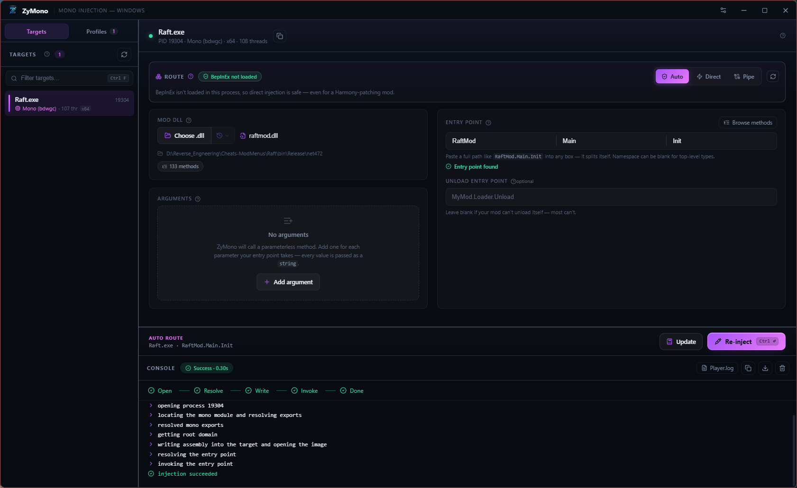
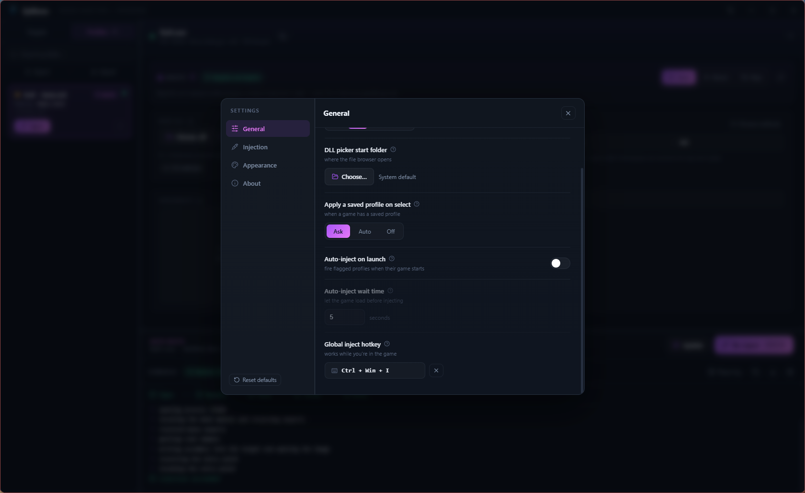
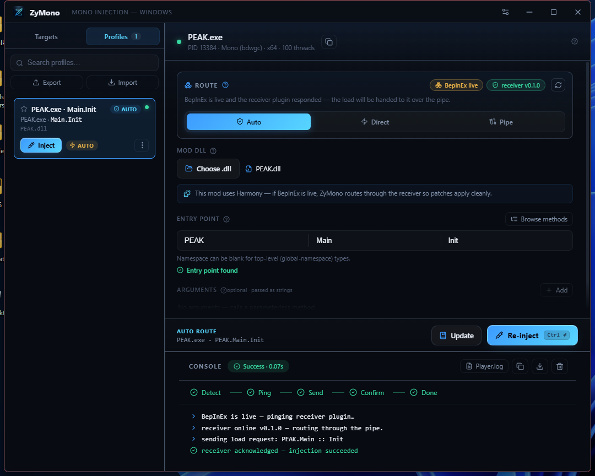

<div align="center">



<h1>ZyMono</h1>

<h3>A modern, Windows-native&nbsp;·&nbsp;<em>Unity</em>&nbsp;·&nbsp;<em>Mono &amp; IL2CPP</em>&nbsp;·&nbsp;game injector</h3>

<p><b>Load your own C# or C++ mod into a Unity game — Mono or IL2CPP — and let ZyMono pick the right route from what's actually running inside the game.</b></p>

<p><i>Direct managed load · BepInEx / MelonLoader pipe with in-game receivers · Native <code>LoadLibrary</code> · In-memory manual map · Proxy preloader · MelonMod &amp; BepInPlugin auto-registration.</i></p>

<p>
<a href="https://github.com/TheHolyOneZ/ZyMono"></a>
<a href="https://github.com/TheHolyOneZ/ZyMono"></a>
<a href="https://github.com/TheHolyOneZ/ZyMono"></a>
<a href="LICENSE"></a>
<a href="https://tauri.app"></a>
</p>

<p>
<a href="https://zlogic.eu/zymono/"></a>
</p>

<p>
<b>🏠 Home &amp; downloads</b> — <a href="https://zlogic.eu/zymono/">zlogic.eu/zymono</a> &nbsp;·&nbsp;
<b>🌐 More projects</b> — <a href="https://zsync.eu">zsync.eu</a> &nbsp;·&nbsp;
<b>🎮 Mods &amp; mod menus</b> — <a href="https://zlogic.eu">zlogic.eu</a>
</p>

<p>Made with care by <b><a href="https://github.com/TheHolyOneZ">TheHolyOneZ</a></b></p>

<br/>



</div>

---

<div align="center">

<a href="#-whats-new-in-031">What's new</a> ·
<a href="#-what-is-zymono">What is it</a> ·
<a href="#-feature-overview">Features</a> ·
<a href="#-how-injection-works">How it works</a> ·
<a href="#-how-zymono-compares">Comparison</a> ·
<a href="#-getting-started">Get started</a> ·
<a href="#-build-it-yourself">Build it yourself</a> ·
<a href="#-compatibility">Compatibility</a> ·
<a href="#-faq">FAQ</a>

</div>

---

## 🆕 What's new in 0.3.1

*A fix release for 0.3.0.*

**🐞 IL2CPP & MelonLoader receiver install fixed**
0.3.0 shipped only the classic BepInEx receiver inside the installer — the BepInEx-IL2CPP and MelonLoader
DLLs were built but never bundled. Installing either from a real (non-dev) install failed with
*"bundled receiver DLL not found — build the … project first"*. All three receivers
(`ZyMonoReceiver.dll`, `ZyMonoReceiverIL2CPP.dll`, `ZyMonoMelonReceiver.dll`) now ship with the app.

**📝 Wording corrected throughout**
ZyMono stopped being a Mono-only injector in 0.3.0, but the app metadata, tray tooltip, title bar and
About panel hadn't caught up. The in-app guide also still claimed *"IL2CPP games aren't injectable
(no Mono runtime)"* — flatly wrong since 0.3.0. All corrected.

---

## 🆕 What's new in 0.3.0

*The IL2CPP release. ZyMono is no longer a Mono-only injector — it now speaks native C++, IL2CPP, BepInEx-IL2CPP, and MelonLoader too.*

<table>
<tr>
<td width="50%" valign="top">

**🎯 IL2CPP games — first-class support**
IL2CPP games are no longer marked "not injectable". ZyMono now knows there are two mod worlds inside every Unity game — **managed C#** and **native C++** — and routes to the right one based on what you actually picked. Select an IL2CPP game, pick a `.dll`, ZyMono inspects it and picks the route for you.

**🧬 Native (C++) mod loading**
Three brand-new routes for native mods that no managed injector can touch:

- **LoadLibrary** — the classic on-demand path. The game itself calls `LoadLibraryW` on your DLL; Windows' own loader runs `DllMain(DLL_PROCESS_ATTACH)` and you're in.
- **Manual map** — an in-memory PE loader. The DLL is copied into the game as a memory buffer, sections copied, relocations applied, imports resolved, `DllMain` fired — no file on disk needs to remain readable. The native analog of the direct Mono route.
- **Proxy preloader** — drops a signed-clean `winhttp.dll` / `version.dll` stub next to the game exe so your mod auto-loads at next launch. The exact mechanism BepInEx and MelonLoader use themselves — now available for your own native mods.

**🧠 DLL-aware routing**
The picker now inspects every DLL you point it at: managed vs native, x86 / x64 / AnyCPU, and — for managed DLLs — whether it carries `[BepInPlugin]` or `[MelonInfo]`. The route panel reshapes around what you picked. A C++ DLL hides the pipe route entirely. A C# DLL hides the native tabs. A wrong-bitness DLL says so up front.

</td>
<td width="50%" valign="top">

**🎭 Two new pipe receivers — BepInEx-IL2CPP & MelonLoader**
The pipe route now covers all three modern Unity mod-loader worlds:

- `ZyMonoReceiver.dll` — BepInEx classic (Mono) — as before
- `ZyMonoReceiverIL2CPP.dll` — **new** — BepInEx-IL2CPP, `BasePlugin` + `Il2CppInterop`, class-injected dispatcher
- `ZyMonoMelonReceiver.dll` — **new** — MelonLoader, `MelonMod` + `OnUpdate`-pumped dispatcher

ZyMono detects which loader is live in the game and installs — or **updates in place** — the matching receiver with one click.

**⚡ MelonMod / BepInPlugin auto-registration**
Drop a MelonMod DLL onto ZyMono and there's **nothing to fill in**. ZyMono spots the `[MelonInfo]` attribute, the entry-point column disappears, and the receiver hands the assembly to `MelonAssembly.LoadMelonAssembly` — MelonLoader runs the full startup pipeline (Register → OnInitializeMelon → OnLateInitializeMelon → OnUpdate hookup) exactly as if the file had been in `Mods/` at launch. The same lane exists for `[BepInPlugin]` via `Chainloader`.

**🔀 Loader detection: BepInEx vs MelonLoader vs none**
The status pill now reads *"MelonLoader live"* / *"BepInEx live"* / *"no mod loader"* correctly — the old "BepInEx live" false positive on MelonLoader games is gone. Uses loader-specific module signatures plus the `winhttp.dll` (BepInEx) vs `version.dll` (MelonLoader) proxy heuristic.

**🩹 UX cleanup**
Direct/Pipe/Auto is hidden when a native DLL is picked (pipe doesn't apply). The "no managed methods found" warning is gone in native mode. Install/Update prompt no longer auto-dismisses after 2 s. **Update receiver…** button when the receiver is already live so you can push a fresh build without hunting through folders. The stale "Uses Harmony — if BepInEx is live" hint is now loader-agnostic.

</td>
</tr>
</table>

---

## 🆕 What's new in 0.2.0

*A release shaped almost entirely by user feedback — every item below came from someone actually modding with it.*

<table>
<tr>
<td width="50%" valign="top">

**🔍 Search / filter the target list**
Type a few letters — `Raft` — and the Targets list narrows instantly. <kbd>Ctrl</kbd>+<kbd>F</kbd> from anywhere jumps into the box; <kbd>Esc</kbd> clears it. No more hunting through thirty processes.

**📋 Paste a whole entry point**
Copy `RaftMod.Main.Init` from anywhere and paste it into **any** of the three entry-point boxes — ZyMono splits it into Namespace / Class / Method for you. It also cleans up what it's given: `RaftMod::Main::Init`, a trailing `(string[] args)`, or a copied log line all resolve correctly.

**📂 Recent DLLs dropdown**
A dropdown next to **Choose DLL** remembers the last **5** assemblies you injected. Re-testing the same mod is now one click instead of a file dialog. Entries can be forgotten individually.

**⌨️ Global inject hotkey**
Bind any combination (<kbd>F11</kbd>, <kbd>Ctrl</kbd>+<kbd>Alt</kbd>+<kbd>I</kbd>, …) in **Settings → Injection** and fire an injection **while the game has focus** — no Alt-Tab. ZyMono toasts what happened, and tells you if there's nothing configured to inject yet.

</td>
<td width="50%" valign="top">

**⏏️ Optional unload / eject entry point**
Give ZyMono a second, optional entry point — `MyMod.Loader.Unload` — and an **Eject** button appears beside **Inject**. It calls that method on the copy of your assembly that is *already live*, so your statics are the ones `Init` set up. Reload a mod without restarting the game. Leave it blank and nothing changes.

**🖱️ Drag-and-drop a DLL**
Drop a `.dll` anywhere on the window to load it. The overlay names the file before you let go, and politely refuses anything that isn't a .NET assembly.

**🧭 Action bar moved next to the target**
**Save** and **Inject** now sit in a dedicated action bar directly under the form, alongside a live summary of *what* is about to be injected *where* — your eyes no longer cross the whole monitor between the target and the button that acts on it.

**🖥️ A real widescreen layout**
Maximize the window and the config panel reflows: one column → **two** at 780 px → **three** at 1500 px. No more 60 % of a widescreen monitor left as empty black space.

**♿ High-contrast mode**
**Settings → Appearance → High contrast** raises borders, surfaces and text contrast across the whole app, on top of whichever accent you use.

</td>
</tr>
</table>

---

## 🧩 What is ZyMono?

**ZyMono** is a clean, powerful desktop app for injecting your mod into a running Unity game on Windows — whether that game runs **Mono** or **IL2CPP**, and whether your mod is written in **C#** or **C++**. You point it at a game, pick your mod DLL, and press **Inject**. ZyMono classifies the DLL, sees what's running inside the game, chooses the correct one of **six** injection routes, and tells you exactly what happened.

Every path is real and lives in-repo:

- **Managed C# into Mono** — direct in-memory `Assembly.Load` via the game's own Mono runtime.
- **Managed C# via BepInEx classic** — pipe route to `ZyMonoReceiver.dll` inside the game.
- **Managed C# via BepInEx-IL2CPP** — pipe route to `ZyMonoReceiverIL2CPP.dll`, plugin auto-registered through `IL2CPPChainloader`.
- **Managed C# via MelonLoader** — pipe route to `ZyMonoMelonReceiver.dll`, mod auto-registered through `MelonAssembly.LoadMelonAssembly`, `OnInitializeMelon` fires exactly as if the file had been in `Mods/` at launch.
- **Native C++ on-demand** — `LoadLibraryW` + `CreateRemoteThread` into any running game.
- **Native C++ in-memory (manual map)** — full PE loader (sections, base relocations, imports, DllMain) — file never leaves your machine.
- **Native C++ preloader** — build-time-generated `winhttp.dll` / `version.dll` proxy stub for auto-load at next launch.

What sets ZyMono apart is that it **doesn't guess**. It inspects the picked DLL (managed vs native, `[BepInPlugin]` vs `[MelonInfo]`, x86 / x64 / AnyCPU) *and* the running process (Mono vs IL2CPP, BepInEx vs MelonLoader vs nothing, is our receiver alive?) — then reshapes its own UI so you can only pick routes that make sense for what you actually have.

> **In one line:** *ZyMono is a smart Unity injector that speaks C# and C++, Mono and IL2CPP, BepInEx and MelonLoader — and picks the right lane, confirmed live, so you never fire blindly.*

---

## ✨ Feature overview

<table>
<tr>
<td width="33%" valign="top">

### 🎯 Targets
- Auto-refreshing list of running Mono / IL2CPP Unity games
- **Search / filter** box (<kbd>Ctrl</kbd>+<kbd>F</kbd>) — type `Raft`, get Raft.exe
- **Mono vs IL2CPP** classification — both are injectable, ZyMono picks the route
- Runtime flavor (`mono` / `mono-2.0-bdwgc` / `il2cpp`), **x86/x64**, thread count
- Loader badges: **BepInEx live**, **MelonLoader live**, receiver status
- Selection **survives a game restart**; clears when the game closes
- Right-click → detail card, copy PID / path, open `Player.log`
- Reads Steam **AppID** from `steam_appid.txt`

</td>
<td width="33%" valign="top">

### 🧠 Smart routing
- Decides from the **live process** *and* the picked DLL — not folders on disk
- Detects **which loader is live**: BepInEx (classic or IL2CPP) or MelonLoader
- Inspects your DLL: **managed vs native**, x86 / x64 / **AnyCPU**, `[BepInPlugin]`, `[MelonInfo]`
- **Auto** picks Direct / Pipe / LoadLibrary / Manual Map — or force any
- Router panel with loader badge, receiver status, one-plain-English reason, `↻` re-probe
- **Harmony** usage detected from your DLL and flagged
- Guided **install / update receiver** flow — picks the correct receiver variant automatically

</td>
<td width="33%" valign="top">

### 🔌 Confirmed delivery
- **Three** in-game receivers, one shared protocol: BepInEx classic, BepInEx-IL2CPP, MelonLoader
- `PING → HELLO`, `LOAD → ACK` — request/response with a version handshake
- Loads **on the Unity main thread** (Photon / Harmony / Il2CppInterop-safe)
- **MelonMod / BepInPlugin auto-registration** — send an empty entry point and the receiver hands the assembly to `MelonAssembly.LoadMelonAssembly` or the appropriate `Chainloader`
- **Acknowledges success** or hands back the exact managed exception
- Receiver **auto-discovery, install, and update-in-place** (incl. Thunderstore / r2modman profiles)

</td>
</tr>
<tr>
<td width="33%" valign="top">

### 💉 Six injection routes
- **Direct** — in-memory Mono load, assembly never written to disk
- **Pipe** — through the in-game receiver on the Unity main thread
- **Native LoadLibrary** — game calls `LoadLibraryW` on your C++ DLL, Windows fires `DllMain`
- **Native Manual Map** — full in-memory PE loader (sections, relocs, imports, DllMain)
- **Proxy preloader** — writes a `winhttp.dll` / `version.dll` stub next to the game exe for auto-load at next launch
- **Auto-registration** — MelonMod / BepInPlugin sniffed from the DLL, no entry point required
- All routes have bounded timeouts, arch validation, pre-inject delay, and clean rejection when the pairing doesn't make sense

</td>
<td width="33%" valign="top">

### 🔎 Entry points
- Reads your DLL's **.NET metadata** (PE → CLI tables) for managed mods
- Browse **Namespace.Class.Method**, grouped and searchable
- Badges: **static / void / arg-count**; "compatible only" filter
- Pick a method → auto-fills the fields and argument slots
- **Live validation:** `✓ Entry point found`, *not found*, or *not static void*
- **Paste `Namespace.Class.Method` into any box** and it splits itself
- Optional **unload entry point** → an **Eject** button appears
- **Native C++ DLLs**: no entry point to fill — `DllMain` is the entry point, the whole column hides
- **MelonMod / BepInPlugin DLLs**: attribute detected — entry-point column hides, receiver auto-registers

</td>
<td width="33%" valign="top">

### 💾 Profiles
- Save a full recipe (DLL + entry point + args + route) **per game**
- Sidebar **Targets / Profiles** tabs
- Cards with **favorite**, live-ready dot, **one-click Inject**, inline rename, ⋮ menu
- **Save / Update / Save-as-new** from the action bar
- **Import / Export** as JSON
- Stored in a **real file** (`%APPDATA%\ZyMono`) so nothing is lost on a crash

</td>
</tr>
<tr>
<td width="33%" valign="top">

### ⚡ Auto-inject
- Flag a profile → it injects **automatically when its game launches**
- Master switch **+ per-profile** flag
- **Configurable wait time** (default 5 s) so the runtime can finish loading
- **Auto-selects** the target it injected into
- Fires once per launch — no double-injects

</td>
<td width="33%" valign="top">

### 🖥️ Live console
- Streaming log with a staged **progress stepper**
  - Direct: `Open → Resolve → Write → Invoke → Done`
  - Pipe: `Detect → Ping → Send → Confirm → Done`
- State chip with **elapsed time**; colour-coded lines
- **Copy / Save / Clear**, auto-scroll
- One click to open the game's **`Player.log`**
- Optional **clear-on-inject**

</td>
<td width="33%" valign="top">

### 🎨 Polished UX
- Frameless window, **close-to-tray**, tray menu (Show / Quit)
- **Resizable** sidebar & console, remembered between runs
- **Drag-and-drop** a `.dll` onto the window
- **Recent DLLs** dropdown — the last 5, one click away
- Action bar with a live *what → where* summary, right under the form
- **Widescreen layout**: 1 → 2 → 3 columns as the window grows
- **6 accent themes** + custom colour picker + **high-contrast mode**
- Shortcuts: <kbd>Ctrl</kbd>+<kbd>Enter</kbd> inject · <kbd>Esc</kbd> cancel · <kbd>Ctrl</kbd>+<kbd>L</kbd> clear · <kbd>Ctrl</kbd>+<kbd>F</kbd> find target
- **Global inject hotkey** — fire from inside the game, no Alt-Tab

</td>
</tr>
</table>

<div align="center">

<br/>
<sub>Categorised settings — process refresh, DLL picker folder, profile autofill, auto-inject on launch with a configurable wait time, and the <b>global inject hotkey</b> that works while you're in the game.</sub>
</div>

---

## 🚀 How injection works

*(the plain-English version)*

A Unity game that uses Mono runs C# internally — the same kind of code your mod is written in. **Injecting** means getting your DLL into that runtime and calling one method inside it (your "entry point") so your mod starts running.

ZyMono supports two ways to do this and **chooses for you**:

Every Unity game process has **two parallel worlds** inside it:

- **The managed world** — C# code running on a .NET runtime (Mono, or a runtime shipped by BepInEx-IL2CPP / MelonLoader on IL2CPP games). This is where mods with `[BepInPlugin]`, `[MelonInfo]`, Harmony patches, and `Namespace.Class.Method` entry points live.
- **The native world** — machine code running directly on the CPU, alongside the game's compiled C++. This is where mods with `DllMain(DLL_PROCESS_ATTACH)` live, loaded by Windows' own loader.

ZyMono knows about both and picks based on what your **DLL** is and what your **game** is running.

### The managed lane — direct or pipe

- **Direct** — when nothing is intercepting the game, ZyMono loads your C# DLL straight into the game's Mono runtime **from memory** and calls your entry method. Fast and self-contained.
- **Pipe** — when a mod loader is live (BepInEx classic, BepInEx-IL2CPP, or MelonLoader), forcing a load can collide. So ZyMono ships **three matching receivers**, one per loader, each a tiny plugin that lives inside the loader. Your DLL is streamed over a named pipe, the receiver **loads it on the game's main thread**, and either **acknowledges** or hands back the exact managed exception.
- **Auto-registration** — if the assembly carries `[MelonInfo]` or `[BepInPlugin]`, no entry point is needed. The receiver hands the assembly to `MelonAssembly.LoadMelonAssembly` / `Chainloader` and the mod runs its full `OnInitializeMelon` / `Load()` lifecycle exactly as it would from `Mods/` or `BepInEx/plugins/` at startup.

### The native lane — LoadLibrary, Manual Map, Proxy

- **LoadLibrary** — the game itself calls `LoadLibraryW` on your C++ DLL (path resolved from the target's own `kernel32` export table so it stays correct injecting into x86 games from x64). Windows fires `DllMain(DLL_PROCESS_ATTACH)` and you're in.
- **Manual Map** — full in-memory PE loader: parse headers, `VirtualAllocEx`, copy sections, apply base relocations (I386 / AMD64), resolve imports across every module in the target (loading missing ones through the game), invoke `DllMain` via a small remote shellcode. Native analog of the direct Mono route — the DLL never has to remain on disk.
- **Proxy preloader** — writes a build-time-generated `winhttp.dll` / `version.dll` stub with forwarded exports and a `DllMain` that `LoadLibraryW`s your mod. Drop-in same mechanism BepInEx and MelonLoader use themselves.

### It decides from what's *actually running* — and what you *actually picked*

> ZyMono does **not** guess from files on disk. It inspects the **live process** (Mono vs IL2CPP, which loader is mapped, whether the receiver answers a ping) *and* your **picked DLL** (managed vs native, x86/x64/AnyCPU, `[BepInPlugin]` vs `[MelonInfo]`). Then it reshapes its own UI so only routes that will actually work are available.

```
             ┌──────────────────────────────────────────┐
             │  Pick a game  +  pick a DLL              │
             └──────────────────┬───────────────────────┘
                                │
                     What kind of DLL is it?
                                │
                ┌───────────────┴───────────────┐
                │ MANAGED (.NET)                │ NATIVE (C++)
                ▼                               ▼
     Which loader is live in game?         Which native route?
     ┌────────────┼────────────┐            ┌───────────┬──────────────┐
     │ none       │ BepInEx    │ MelonLdr   │ LoadLib   │ Manual Map   │
     ▼            ▼            ▼            ▼           ▼
   Direct      Pipe →       Pipe →      OS loader   In-memory PE
   (Mono)      classic /    MelonMod    fires        loader, DllMain
               IL2CPP       auto-reg    DllMain      fired remotely
               receiver
                                        (Optional: install a winhttp /
                                         version proxy for auto-load at
                                         next launch)
```

<div align="center">

<br/>
<sub>Profiles &amp; one-click inject — favourites, auto-inject flags, import/export, and a live dot when the profile's game is running.</sub>
</div>

---

## 🆚 How ZyMono compares

ZyMono builds on the well-known **SharpMonoInjector (SMI)** technique and an earlier **pipe-injection fork** of it, and pushes both further. An honest comparison:

<div align="center">

| Capability | SharpMonoInjector | SMI pipe fork | **ZyMono** |
|:---|:---:|:---:|:---:|
| Direct in-memory load (managed) | ✅ | ✅ | ✅ |
| Pipe route through an in-game receiver | ❌ | ✅ *(BepInEx classic only)* | ✅ **3 receivers** (classic · IL2CPP · MelonLoader) |
| **IL2CPP** game support | ❌ | ❌ | ✅ via native + IL2CPP receivers |
| **MelonLoader** detection & bridge | ❌ | ❌ | ✅ full pipeline |
| **Native C++ mod** injection (LoadLibrary) | ❌ | ❌ | ✅ |
| **In-memory manual map** for native mods | ❌ | ❌ | ✅ |
| **Proxy preloader** (winhttp / version stub) | ❌ | ❌ | ✅ generated at install time |
| MelonMod / BepInPlugin **auto-registration** | ❌ | ❌ | ✅ zero entry-point config |
| Decides route from the **live process** *and* the picked DLL | ❌ | ⚠️ from a disk folder | ✅ |
| **Confirms** the mod actually loaded | ❌ | ❌ | ✅ ping + ack |
| Loads on the Unity **main thread** (Harmony/Photon-safe) | ❌ | ⚠️ | ✅ |
| Automatic route selection | ❌ | ❌ | ✅ |
| DLL classification (managed / native / AnyCPU / attributes) | ❌ | ❌ | ✅ |
| Entry-point **validation** before injecting | ❌ | ❌ | ✅ |
| Detects **Harmony** usage in your DLL | ❌ | ❌ | ✅ |
| Saved **profiles** + one-click inject | ❌ | ⚠️ | ✅ |
| **Auto-inject** on launch | ❌ | ✅ | ✅ *(configurable delay)* |
| Receiver auto-discovery, install, & **update-in-place** | ❌ | ❌ | ✅ correct variant picked |
| **Global hotkey** — inject without Alt-Tabbing | ❌ | ❌ | ✅ |
| **Eject / reload** a mod without restarting the game | ❌ | ❌ | ✅ *(optional unload entry point)* |
| Searchable target list · recent DLLs · paste-to-split entry point | ❌ | ❌ | ✅ |
| High-contrast mode & adaptive widescreen layout | ❌ | ❌ | ✅ |
| Interface | WinForms / CLI | varies | Modern native UI (Tauri) |

</div>

### Is it better than SMI or the fork?

For simple cases, plain **SharpMonoInjector** is a fine, minimal tool and deserves credit — ZyMono stands on its shoulders. But it was built for a simpler world: it loads your DLL directly and assumes that's always safe.

The **pipe fork** added the idea of handing the load to a plugin inside BepInEx — the right instinct. But it decided *whether* to do that by checking for a **BepInEx folder on disk**, and it sent the load with **no confirmation**. So it could route the wrong way (a folder existing doesn't mean BepInEx actually started with the game), and you never really knew if your mod loaded.

**ZyMono fixes both:**

- ✅ It checks whether **BepInEx is genuinely live in the running process** — and pings the receiver — before choosing a route. If no loader is actually running, direct injection is used even when a BepInEx folder is present.
- ✅ Its receiver is a proper **request/response** protocol: it **acknowledges** a successful load or hands back the exact exception, and it loads on the **main thread** so Harmony patches apply cleanly.

Add profiles, auto-inject, entry-point validation, Harmony detection and a modern UI, and ZyMono becomes a noticeably more reliable and pleasant tool for real-world Unity modding — while staying focused purely on **injection** (it is not a mod-loader installer).

---

## 📥 Getting started

> 📦 **Download ZyMono for Windows (v0.3.1)** from the official page: **[zlogic.eu/zymono](https://zlogic.eu/zymono/)** — grab the installer (.exe) or MSI right there.
> Signed and auto-updating — future versions install themselves from inside the app. This GitHub repo is the **source code**; prefer not to run a pre-built binary? **[Build it yourself](#-build-it-yourself)** in a couple of minutes.

1. **Launch your game.** It appears in the **Targets** list on the left, with its runtime and architecture.
2. **Select the game.** ZyMono shows what's live inside it and pre-picks a route.
3. **Choose your mod `.dll`** — browse for it, drag-and-drop it onto the window, or pick it from **Recent**. Set its entry point: paste the whole `Namespace.Class.Method` into any box and ZyMono splits it for you. It confirms the method exists: `✓ Entry point found`. Not sure of the name? Hit **Browse methods**.
4. **Leave the route on Auto** *(recommended)* and press **Inject**. Watch the console step through `Detect → Ping → Send → Confirm → Done`.
5. **Save it as a Profile** so next time it's one click — or flag it for **Auto-inject** so it fires the moment the game launches.
6. *(Optional)* Set a **global hotkey** in Settings and re-inject from inside the game, or fill in an **unload entry point** to get an **Eject** button that reloads your mod without restarting.

> 💡 ZyMono injects into **both Mono and IL2CPP** games. Pick your DLL — the mode toggle and route panel reshape around it automatically. Native C++ mods route through LoadLibrary / Manual Map; C# mods route through the pipe if a loader is live, or Direct if not.

---

## 🔧 Build it yourself

Building from source guarantees the app matches the code you can read here — ideal if you'd rather not trust a pre-built download.

<details>
<summary><b>Prerequisites</b> (Windows 10 / 11, x64)</summary>

<br/>

- **[Rust](https://rustup.rs)** — stable toolchain (MSVC)
- **[Node.js](https://nodejs.org) LTS** + **pnpm** — `npm install -g pnpm`
- **Microsoft Visual C++ Build Tools** with the **Windows 10/11 SDK**
- **WebView2 Runtime** — already present on Windows 11
- *(Only to rebuild the in-game receiver plugin)* the **.NET SDK 6.0+** and the **.NET Framework 4.7.2** targeting pack

</details>

### Build the app

```bash
git clone https://github.com/TheHolyOneZ/ZyMono
cd ZyMono
pnpm install
pnpm tauri build
```

Installers land in `src-tauri/target/release/bundle/` — an NSIS `setup.exe` and an MSI.
To run a live development build instead:

```bash
pnpm tauri dev
```

<details>
<summary><b>Build the in-game receiver</b> (optional)</summary>

<br/>

The pipe route uses one of **three** small plugins depending on which loader is live in the target game — one per project, one shared code core:

```bash
dotnet build ZyMono.Receiver           -c Release   # BepInEx classic (Mono) → ZyMonoReceiver.dll
dotnet build ZyMono.Receiver.IL2CPP    -c Release   # BepInEx-IL2CPP        → ZyMonoReceiverIL2CPP.dll
dotnet build ZyMono.MelonReceiver      -c Release   # MelonLoader           → ZyMonoMelonReceiver.dll
```

The MelonReceiver csproj auto-downloads MelonLoader on first build (`lib/` cache). The BepInEx variants pull from the official BepInEx NuGet feed via `nuget.config`. ZyMono installs the correct variant based on `detect_loader(pid) + engine`, into `BepInEx/plugins/` or `Mods/` as appropriate.

</details>

---

## 🧩 Compatibility

<div align="center">

| | Status |
|:---|:---|
| **OS** | Windows 10 / 11 (x64) |
| **Game runtime — Mono** | ✅ full support — both classic `mono.dll` and modern `mono-2.0-bdwgc.dll` |
| **Game runtime — IL2CPP** | ✅ via native injection (LoadLibrary / Manual Map / Proxy preloader) or via a BepInEx-IL2CPP / MelonLoader receiver |
| **Architecture** | x86 **and** x64 games; managed AnyCPU DLLs load into either bitness |
| **Mod language — C# / managed** | ✅ via Direct or Pipe (three receiver variants) |
| **Mod language — C++ / native** | ✅ via LoadLibrary, in-memory Manual Map, or Proxy preloader |
| **Mod loaders detected & bridged** | **BepInEx classic** (Mono), **BepInEx-IL2CPP**, **MelonLoader**, or no loader at all |
| **Auto-registration** | ✅ `[MelonInfo]` MelonMods and `[BepInPlugin]` plugins — no entry point required |
| **Proxy preloader (native)** | ✅ x64 games — `winhttp.dll` / `version.dll` stub with forwarded exports |

</div>

---

## ❓ FAQ

<details>
<summary><b>Does my mod need BepInEx?</b></summary>
<br/>
No. If the game isn't running a loader, ZyMono injects directly. If it <em>is</em>, ZyMono routes through the receiver so your mod — and its Harmony patches — load cleanly.
</details>

<details>
<summary><b>Why did it choose the pipe route?</b></summary>
<br/>
Because it detected BepInEx actually running in the game <em>and</em> the receiver answered a ping. That's the safe path when a loader is live.
</details>

<details>
<summary><b>My mod uses Harmony — is that a problem?</b></summary>
<br/>
No — that's exactly the case the pipe route handles. ZyMono even flags Harmony usage in your DLL so you understand the routing.
</details>

<details>
<summary><b>It says "no receiver".</b></summary>
<br/>
The receiver plugin isn't loaded in the game yet. Use ZyMono's <em>Install receiver</em> flow — it picks the correct variant (BepInEx classic, BepInEx-IL2CPP, or MelonLoader) based on what's live and drops it into the right folder (<code>BepInEx/plugins/</code> or <code>Mods/</code>). Relaunch the game — or use Direct / native routes if a loader isn't running.
</details>

<details>
<summary><b>Is IL2CPP supported?</b></summary>
<br/>
Yes — as of 0.3.0. IL2CPP has no Mono runtime, so managed C# mods only work if a compatible loader is live (BepInEx-IL2CPP or MelonLoader) and ZyMono streams the DLL to the matching receiver over the pipe. But <b>native C++ mods</b> load directly into any IL2CPP game via LoadLibrary or the in-memory Manual Map route — Windows is the loader, no runtime needed. There's also a Proxy preloader for auto-load at next launch.
</details>

<details>
<summary><b>Does ZyMono work with MelonLoader?</b></summary>
<br/>
Yes. ZyMono ships <code>ZyMonoMelonReceiver.dll</code> — a real <code>MelonMod</code> with a pipe server and an <code>OnUpdate</code>-pumped dispatcher. Drop a MelonMod DLL onto ZyMono and it detects the <code>[MelonInfo]</code> attribute, hides the entry-point column, and (on inject) hands the assembly to <code>MelonAssembly.LoadMelonAssembly</code> — MelonLoader runs the full <code>OnInitializeMelon</code> / <code>OnLateInitializeMelon</code> / <code>OnUpdate</code> lifecycle exactly as if the file had been in <code>Mods/</code> at startup.
</details>

<details>
<summary><b>What's the difference between LoadLibrary and Manual Map?</b></summary>
<br/>
Both load a native C++ mod into a running game, but differ in where the DLL lives. <b>LoadLibrary</b> has the game call <code>LoadLibraryW</code> on your DLL — Windows' own loader maps it from disk and fires <code>DllMain</code>. <b>Manual Map</b> copies the DLL into the game as a memory buffer and runs the whole loader itself: section copy, base relocations, imports resolved through the target's own modules, then <code>DllMain</code> via a small remote shellcode. Use Manual Map when you want the file to never remain on disk (single self-contained mods); use LoadLibrary when your mod loads side files by relative path.
</details>

<details>
<summary><b>What is the Proxy preloader for?</b></summary>
<br/>
It's the same mechanism BepInEx and MelonLoader use to bootstrap themselves — a tiny <code>winhttp.dll</code> or <code>version.dll</code> stub next to the game exe with forwarded exports and a <code>DllMain</code> that <code>LoadLibraryW</code>s your mod. Drop it in once, and every future game launch auto-loads your native mod before ZyMono is even open. Currently x64 only.
</details>

<details>
<summary><b>Can I reload my mod without restarting the game?</b></summary>
<br/>
Yes, if your mod supports it. Fill in the optional <b>unload entry point</b> (e.g. <code>MyMod.Loader.Unload</code>) and an <b>Eject</b> button appears next to Inject. ZyMono calls that method on the copy of your assembly that is <em>already loaded</em>, so the statics it tears down are the ones your <code>Init</code> set up. Then just Inject again. Most mods can't unload themselves — leave the box blank and nothing changes.
</details>

<details>
<summary><b>Can I inject without Alt-Tabbing out of the game?</b></summary>
<br/>
Yes. Set a <b>global inject hotkey</b> in <em>Settings → Injection</em> (<kbd>F11</kbd>, <kbd>Ctrl</kbd>+<kbd>Alt</kbd>+<kbd>I</kbd>, anything you like). Once a target and DLL are configured, the hotkey fires an injection while the game has focus and ZyMono toasts the result.
</details>

<details>
<summary><b>Where does ZyMono store my profiles and settings?</b></summary>
<br/>
Profiles live in a real file at <code>%APPDATA%\ZyMono\profiles.json</code> (so they survive crashes and force-kills). App settings and window layout are kept per-user as well.
</details>

---

## ⚖️ Legal &amp; responsible use

ZyMono is a general-purpose modding tool for **Mono/Unity games you own**, provided for **educational and personal use**. It is intended for single-player and legitimate modding scenarios. You are responsible for complying with the terms of service of any game you use it with. **The developers are not responsible for how others choose to use this tool.** Don't use it to gain an unfair advantage in online/competitive games, or in any way that violates a game's rules.

---

## 🙏 Credits

- Created &amp; maintained by **[TheHolyOneZ](https://github.com/TheHolyOneZ)**.
- The injection technique builds on the **SharpMonoInjector** lineage and an earlier pipe-injection fork — reworked here with **live-process routing** and a **confirming receiver**.
- Powered by **[Tauri](https://tauri.app)**, **Rust**, **React** + **TypeScript**, and **[BepInEx](https://github.com/BepInEx/BepInEx)** for the receiver plugin.

<div align="center">

### More from TheHolyOneZ

[](https://zsync.eu)
[](https://zlogic.eu)
[](https://github.com/TheHolyOneZ)
[](https://zlogic.eu/zymono/)

</div>

---

## 📄 License

ZyMono is released under the **[GNU General Public License v3.0](LICENSE)** (`GPL-3.0-only`).
© 2026 **TheHolyOneZ**.

---

<div align="center">

<sub><b>Keywords:</b> mono injector · unity mod injector · windows dll injection · bepinex injector · harmony · sharpmonoinjector alternative · C# mod loader · unity game modding tool · mono unity injector windows</sub>

<br/><br/>

<sub>Built with 💜 by <a href="https://github.com/TheHolyOneZ">TheHolyOneZ</a> · <a href="https://zsync.eu">zsync.eu</a> · <a href="https://zlogic.eu">zlogic.eu</a></sub>

</div>
